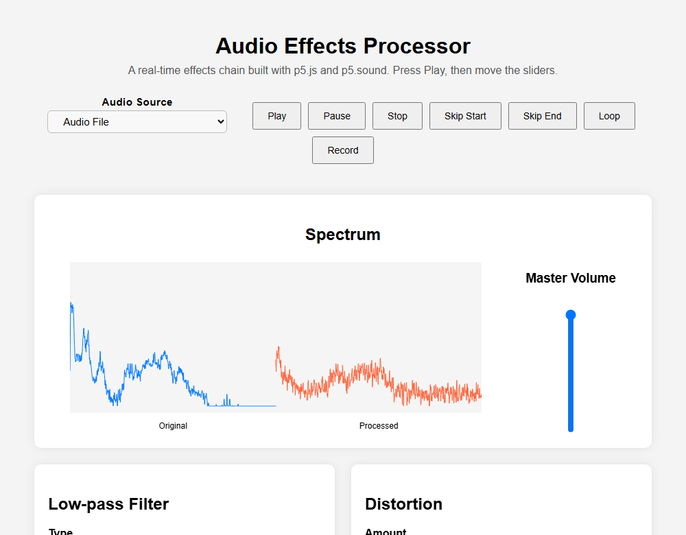
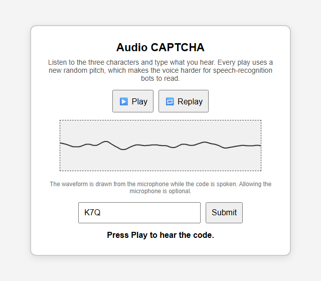
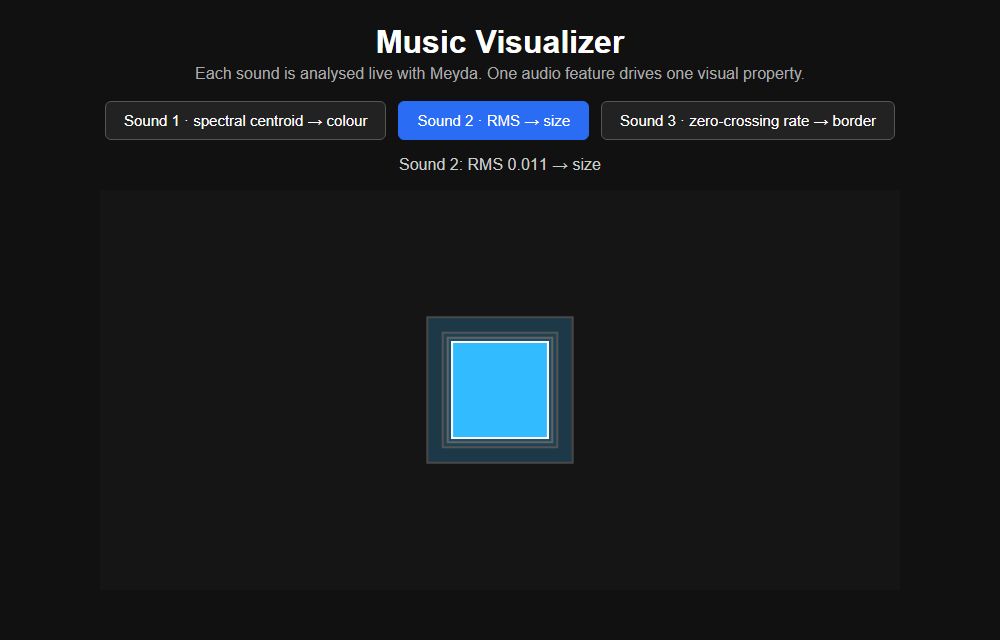
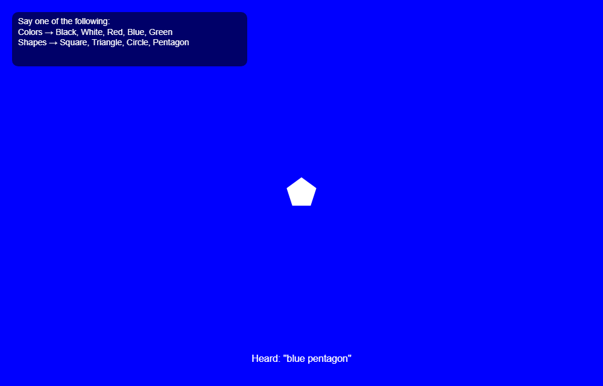

# Web Audio Apps

Four interactive audio apps that run in the browser, built with **p5.js**, **p5.sound**, **p5.speech** and **Meyda**. No install and no build step.

**Live demo: [ziadelh.github.io/web-audio-apps](https://ziadelh.github.io/web-audio-apps/)**

<table>
  <tr>
    <td width="50%"><a href="https://ziadelh.github.io/web-audio-apps/audio-effects-processor/"></a></td>
    <td width="50%"><a href="https://ziadelh.github.io/web-audio-apps/audio-captcha/"></a></td>
  </tr>
  <tr>
    <td width="50%"><a href="https://ziadelh.github.io/web-audio-apps/music-visualizer/"></a></td>
    <td width="50%"><a href="https://ziadelh.github.io/web-audio-apps/voice-controlled-visualizer/"></a></td>
  </tr>
</table>

## The apps

| App | What it does | Try it |
|---|---|---|
| **Audio Effects Processor** | A real-time effects chain with a live comparison of the original and processed spectrum, microphone input and WAV recording | [Open](https://ziadelh.github.io/web-audio-apps/audio-effects-processor/) |
| **Audio CAPTCHA** | Speaks a random three-character code at a random pitch, with a live waveform and a forgiving answer check | [Open](https://ziadelh.github.io/web-audio-apps/audio-captcha/) |
| **Music Visualizer** | Meyda audio features of three sounds drive the colour, size and border of a shape | [Open](https://ziadelh.github.io/web-audio-apps/music-visualizer/) |
| **Voice-Controlled Visualizer** | Say a colour or a shape to change the visual while a track plays | [Open](https://ziadelh.github.io/web-audio-apps/voice-controlled-visualizer/) |

Use Chrome or Edge on a desktop. Voice control needs one of them, and the browser asks for microphone access in the CAPTCHA (optional), when you pick the microphone in the effects processor, and in the voice-controlled visualizer.

## How they work

**Audio Effects Processor.** The signal runs through `source → filter → distortion → delay → compressor → reverb → master volume → output`. The filter switches between low-pass, high-pass and band-pass, and every effect has its own dry/wet control. Two FFT analysers draw the spectrum before and after the chain side by side. The source can be the audio file or the microphone (use headphones to avoid feedback), and the Record button saves the processed signal as a WAV file. It started from a small p5.js starter template; the effects chain, controls, spectrum comparison, recording and microphone input are my own. Moving a slider updates only that effect, so the reverb's impulse response is not rebuilt while you change something else. The delay starts at Dry/Wet 0, so the sound is unchanged until you turn it up.

**Audio CAPTCHA.** Generates three random letters or digits and reads them aloud with speech synthesis at a slow rate and a random pitch between 0.9 and 2.0, which makes the voice harder for speech-recognition bots to transcribe. A waveform is drawn from the microphone while the code is spoken. Answers are normalised before they are compared, so `one two three`, `1 2 3` and `123` all match. The correct code is never written to the console.

**Music Visualizer.** A Meyda analyser runs on each sound with a 512-sample buffer. Sound 1 maps the **spectral centroid** (brightness) to hue, sound 2 maps **RMS** (loudness) to the size of the square, and sound 3 maps the **zero-crossing rate** (noisiness) to the border thickness. The live value of the active feature is shown above the canvas.

**Voice-Controlled Visualizer.** Continuous speech recognition listens for black, white, red, blue or green to change the background, and square, triangle, circle or pentagon to change the figure. The figure's size follows the RMS of the track, the screen shows the words that were heard, and the figure turns dark when the background is white so it never disappears.

## Run it locally

The apps load audio files, so open them through a local server rather than from the file system:

```bash
git clone https://github.com/ziadelh/web-audio-apps.git
cd web-audio-apps
python -m http.server 8000
```

Then open http://localhost:8000.

## Credits

- Music in the voice-controlled visualizer: *Kalte Ohren (Remix)* by Dysfunction_AL (ft. Starfrosch, Kara Square), licensed under [CC BY 3.0](https://creativecommons.org/licenses/by/3.0/) via [ccMixter](http://ccmixter.org/files/destinazione_altrove/59536).
- The sample sounds in the effects processor and the music visualizer come from the course.
- Libraries are loaded from CDNs: p5.js and p5.sound (1.3.1, 1.4.0 and 1.6.0 as each app needed), [p5.speech](https://github.com/IDMNYU/p5.js-speech) 0.0.3 and [Meyda](https://meyda.js.org/) 5.6.3.

## Tech Stack

JavaScript · p5.js · p5.sound · Web Audio API · Web Speech API · Meyda · HTML · CSS

## Author

Ziad Elhussein
